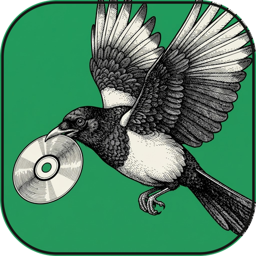

  

## 🧑‍💻 About Me

<table>
<tr>
<td width="55%" valign="top">

- 🔭 **Junior Data Scientist** — I automate marketing workflows using the **Perplexity**, **OpenAI** and **Apollo.io** APIs
- 🕸️ **Resilient web scraping** — extractors that adapt on their own when websites change their structure (**Octopus**)
- 🎧 **AI for audio & video** — transcription, translation and summaries, from the command line or a GUI (**EchoScript**, **MediaFlow**)
- 🖥️ **Python desktop apps** — interfaces built with **Flet** and **CustomTkinter**, made for people who never open a terminal

</td>
<td width="45%" valign="top">

</td>
</tr>
</table>

## 🛠️ Tech Stack

  

<table align="center">
<tr>
<td><b>🧠 Data & ML</b></td>
<td>

</td>
</tr>
<tr>
<td><b>📊 Visualization</b></td>
<td>

</td>
</tr>
<tr>
<td><b>🤖 AI & APIs</b></td>
<td>

</td>
</tr>
<tr>
<td><b>🖥️ GUI & Scripting</b></td>
<td>

</td>
</tr>
<tr>
<td><b>📁 Office</b></td>
<td>

</td>
</tr>
</table>

## 🚀 Projects

<table align="center">
<tr>
<td align="center" width="50%">

 
<a href="https://github.com/Imkun-on/Octopus"><b>Octopus</b></a>
 
Adaptive scraper for reviews, articles and books
</td>
<td align="center" width="50%">

 
<b>Procyon</b>
 
Currently unavailable
</td>
</tr>
<tr>
<td align="center" width="50%">

 
<a href="https://github.com/Imkun-on/MediaFlow"><b>Pica</b></a>
 
All your audio and video, in one place
</td>
<td align="center" width="50%">

 
<a href="https://github.com/Imkun-on/EchoScript"><b>EchoScript</b></a>
 
Transcribe, translate and summarize audio &amp; video
</td>
</tr>
</table>

## 📈 GitHub Stats

  
  

  

  <b>🤝 Let's connect!</b>  
  
  

